# ✦ Claude Toolkit

**An opinionated collection of skills, agents, and engineering practices for Claude Code.**

I like challenging outdated patterns, so some skills might push you to modernise code that technically still works. They're intentionally opinionated, but grounded in established practices rather than personal preferences.

That approach comes from my interests in frontend engineering, UX, and modern development practices. From the human-centred design principles explored by Don Norman in [*The Design of Everyday Things*](https://en.wikipedia.org/wiki/The_Design_of_Everyday_Things) to official framework documentation, the skills reflect what I've learned and how I like to work.

Use the skills independently or through **The Committee**, a collection of specialised agents.

## The Committee

Five specialised agents, each with a distinct responsibility. They work independently, drawing on reusable skills to investigate, design, debug, review, and maintain software.

```mermaid
---
config:
  theme: base
  look: classic
  themeVariables:
    background: "#0D1117"
    fontFamily: "Arial, Helvetica, sans-serif"
    fontSize: "16px"
  flowchart:
    curve: stepAfter
    nodeSpacing: 20
    rankSpacing: 40
    wrappingWidth: 240
    minNodeWidth: 170
---
flowchart TB
    subgraph PANEL[" "]
        direction TB

        C("✦ The Committee")

        C --- R("⌕ The Researcher")
        C --- D("⌘ The Designer")
        C --- I("{ } The Inspector")
        C --- G("⛭ The Debugger")
        C --- L("▤ The Librarian")
    end

    classDef primary fill:#14213D,stroke:#14213D,color:#FFFFFF,stroke-width:2px
    classDef outlined fill:#FFFFFF,stroke:#4169A1,color:#14213D,stroke-width:1.5px

    class C primary
    class R,D,I,G,L outlined

    style PANEL fill:#0D1117,stroke:#0D1117,stroke-width:0px

    linkStyle default stroke:#FCA311,stroke-width:1.6px
```

## Meet the Committee

Explore each agent's responsibilities and the skills it uses.

<strong>⌕ The Researcher</strong> — Context & Evidence

Investigates requirements, dependencies and existing implementations. Verifies claims against evidence rather than assumptions.

**Modes:** Investigate · Verify · Scope

**Skills**
- [context-investigation](skills/context-investigation/SKILL.md)
- [evidence-synthesis](skills/evidence-synthesis/SKILL.md)

[View agent](agents/researcher.md)

<strong>⌘ The Designer</strong> — Product Design & UX

Creates, reviews and modernises interfaces across interaction design, visual design and accessibility.

**Modes:** Create · Review · Modernise

**Skills**
- [interaction-design](skills/interaction-design/SKILL.md)
- [visual-design](skills/visual-design/SKILL.md)
- [design-systems](skills/design-systems/SKILL.md)
- [responsive-design](skills/responsive-design/SKILL.md)
- [user-research](skills/user-research/SKILL.md)
- [ux-writing](skills/ux-writing/SKILL.md)
- [a11y-best-practices](skills/a11y-best-practices/SKILL.md)
- [css-best-practices](skills/css-best-practices/SKILL.md)

[View agent](agents/designer.md)

<strong>{ } The Inspector</strong> — Code Quality & Modernisation

Independently reviews code for correctness, security, maintainability and opportunities to modernise existing implementations.

**Skills**
- [react-best-practices](skills/react-best-practices/SKILL.md)
- [next-best-practices](skills/next-best-practices/SKILL.md)
- [typescript-best-practices](skills/typescript-best-practices/SKILL.md)
- [css-best-practices](skills/css-best-practices/SKILL.md)
- [a11y-best-practices](skills/a11y-best-practices/SKILL.md)
- [security-review](skills/security-review/SKILL.md)
- [test-layers](skills/test-layers/SKILL.md)

[View agent](agents/inspector.md)

<strong>⛭ The Debugger</strong> — Root Cause & Verification

Diagnoses failures through reproducible evidence and controlled experiments. Implements and verifies fixes when requested.

**Modes:** Investigate · Fix · Verify

**Skills**
- [systematic-debugging](skills/systematic-debugging/SKILL.md)
- [test-layers](skills/test-layers/SKILL.md)
- [evidence-synthesis](skills/evidence-synthesis/SKILL.md)
- [conventional-commits](skills/conventional-commits/SKILL.md)

[View agent](agents/debugger.md)

<strong>▤ The Librarian</strong> — Engineering Knowledge & Standards

Maintains engineering guidance, verifies authoritative sources and identifies outdated practices.

**Modes:** Audit · Update · Monitor

**Skills**
- [toolkit-maintenance](skills/toolkit-maintenance/SKILL.md)
- [evidence-synthesis](skills/evidence-synthesis/SKILL.md)
- [conventional-commits](skills/conventional-commits/SKILL.md)

[View agent](agents/librarian.md)

