# ✦ Claude Toolkit

**An opinionated collection of skills, agents, and engineering practices for Claude Code.**

I like challenging outdated patterns, so some skills might push you to modernise code that technically still works. They're intentionally opinionated, but grounded in established practices rather than personal preferences.

That approach comes from my interests in frontend engineering, UX, and modern development practices. From the human-centred design principles explored by Don Norman in [*The Design of Everyday Things*](https://en.wikipedia.org/wiki/The_Design_of_Everyday_Things) to official framework documentation, the skills reflect what I've learned and how I like to work.

Use the skills independently or through **The Committee**, a collection of specialised agents.

## The Committee

Five specialised agents, each with a distinct responsibility. They work independently, drawing on reusable skills to investigate, design, debug, review, and maintain software.

```mermaid
---
config:
  theme: base
  themeVariables:
    background: "#0D1117"
  flowchart:
    curve: stepAfter
    nodeSpacing: 30
    rankSpacing: 60
---
flowchart TB
    subgraph PANEL[" "]
        direction TB

        C("✦ The Committee")

        C --- R("⌕ The Researcher")
        C --- D("⌘ The Designer")
        C --- I("{ } The Inspector")
        C --- G("⛭ The Debugger")
        C --- L("▤ The Librarian")
    end

    classDef primary fill:#14213D,stroke:#14213D,color:#FFFFFF,stroke-width:2px
    classDef outlined fill:#FFFFFF,stroke:#4169A1,color:#14213D,stroke-width:1.5px

    class C primary
    class D,R,G,I,L outlined

    style PANEL fill:#0D1117,stroke:#0D1117,stroke-width:0px

    linkStyle default stroke:#FCA311,stroke-width:1.6px
```

